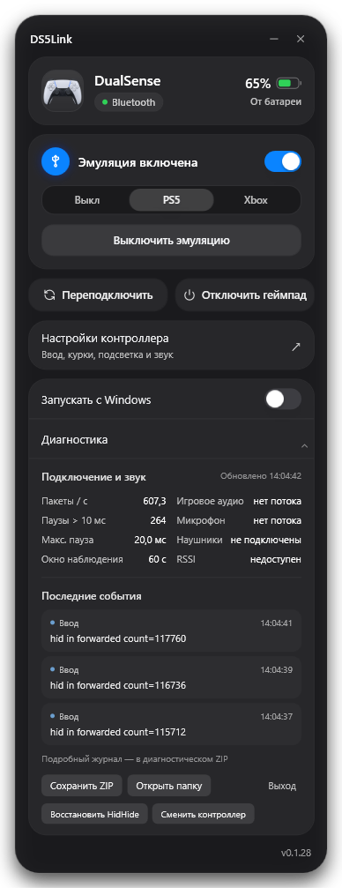
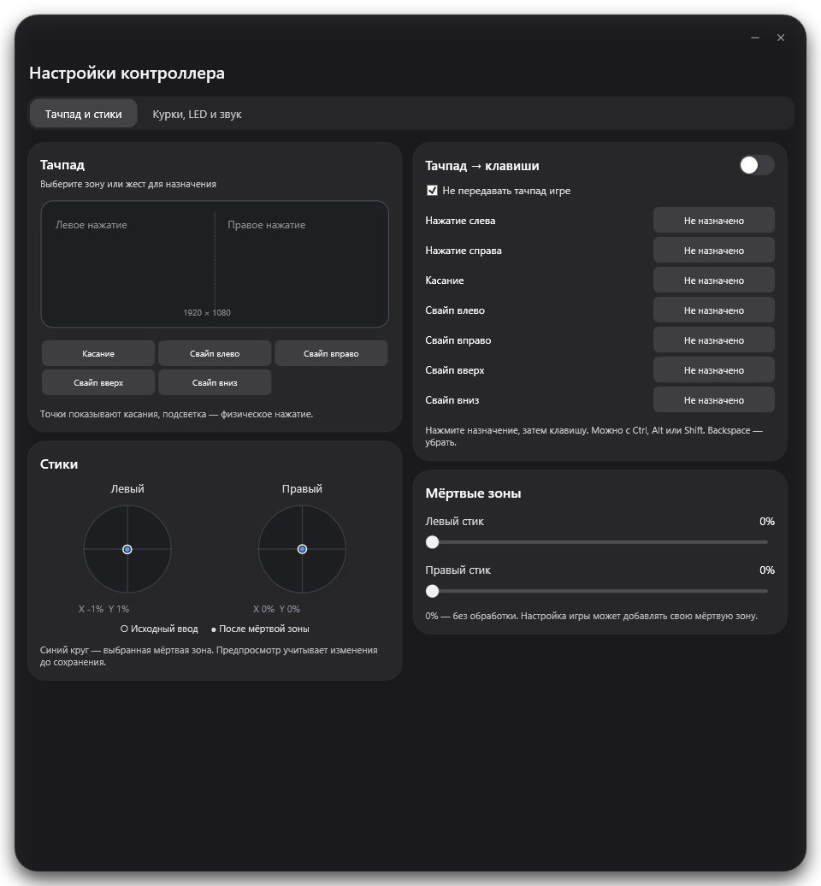
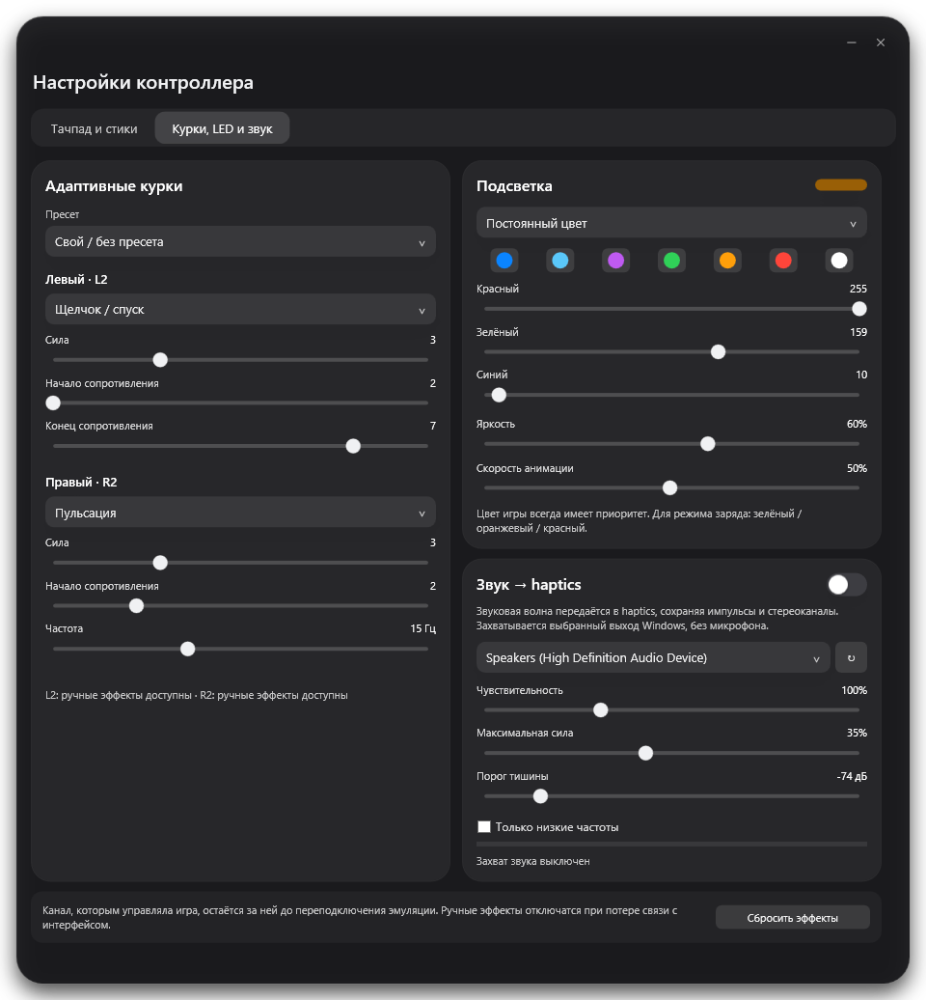
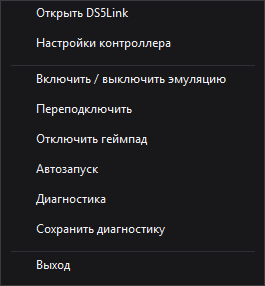

# DS5Link

DualSense по Bluetooth с возможностями проводного подключения на Windows.

**[Скачать DS5Link 0.1.28](https://github.com/Q1W1RTY/DS5Emu/releases/download/v0.1.28/DS5Link-Setup.exe)** · [Релиз](https://github.com/Q1W1RTY/DS5Emu/releases/latest) · [Инструкция](docs/user/INSTALL.md)

Windows 11 x64 · DualSense · Bluetooth / USB

## Возможности

- **PS5-режим:** виртуальный USB DualSense, нативные адаптивные курки, HD haptics и звук в поддерживаемых играх.
- **Xbox-режим:** Xbox 360 / XInput по Bluetooth и USB, обычная игровая вибрация.
- **Настройки ввода:** мёртвые зоны стиков и назначение клавиш на зоны и жесты тачпада с наглядным предпросмотром.
- **Курки:** отдельные эффекты для L2 и R2, сила сопротивления и пресеты.
- **LED:** постоянный цвет, пульсация, радуга и индикация заряда.
- **Звук → haptics:** отдача от выбранного звукового выхода Windows, чувствительность и порог тишины. Доступно в PS5-режиме.
- **Удобства:** автоматическое применение настроек, работа в трее, автозапуск, заряд батареи и диагностический ZIP.

Игра имеет приоритет над ручными эффектами для каналов, которыми она управляет.

## Интерфейс

Скриншоты версии **0.1.28**. Нажмите на изображение, чтобы открыть в полном размере.

<table>
<tr><th>Главное окно</th><th>Диагностика</th></tr>
<tr>
<td valign="top" align="center"></td>
<td valign="top" align="center"></td>
</tr>
</table>

### Тачпад и стики

Зоны и жесты тачпада, назначения клавиш, положение стиков и мёртвые зоны.

### Курки, LED и звук

Все параметры в одном окне: L2 / R2, режимы подсветки и звуковая отдача.

<table>
<tr><th>Установщик</th><th>Меню в трее</th></tr>
<tr>
<td valign="top" align="center"></td>
<td valign="top" align="center"></td>
</tr>
</table>

## Установка

1. Скачать и запустить **DS5Link-Setup.exe** из [последнего релиза](https://github.com/Q1W1RTY/DS5Emu/releases/latest).
2. Установщик проверит зависимости. Установить недостающие драйверы и приложение; совместимые установленные драйверы пропускаются.
3. Для Bluetooth удерживать **Create + PS** до мигания и добавить DualSense в параметрах Windows.
4. Открыть DS5Link и выбрать **PS5** или **Xbox**.

Нужны Windows 11 x64, обычный DualSense и права администратора для установки. Если установщик попросит перезагрузку, выполнить её. По USB доступна эмуляция Xbox; PS5-режим предназначен для Bluetooth.

## Что учитывать

- Нативные эффекты и звук геймпада зависят от поддержки DualSense в игре. Если мешает Steam Input, отключить его для этой игры; другие программы эмуляции закрыть.
- Windows может выбрать DualSense основным звуковым устройством. При необходимости вернуть привычный выход или микрофон в параметрах звука.
- Если после обновления LED не горит, удерживать PS около 10 секунд для полного выключения геймпада и включить его снова.
- Установщик приложения пока не подписан сертификатом издателя; драйверы используют собственные подписанные установщики. Полная игровая проверка последней сборки ещё не завершена.

## Разработка

[Сборка и тесты](docs/development/BUILD.md) · [Архитектура](docs/architecture/ARCHITECTURE.md) · [История изменений](docs/releases/CHANGELOG.md)

Основа эмуляции — [vDS](https://github.com/hurryman2212/vds). Драйверы: [usbip-win2](https://github.com/vadimgrn/usbip-win2), [HidHide](https://github.com/nefarius/HidHide) и [ViGEmBus](https://github.com/nefarius/ViGEmBus).
