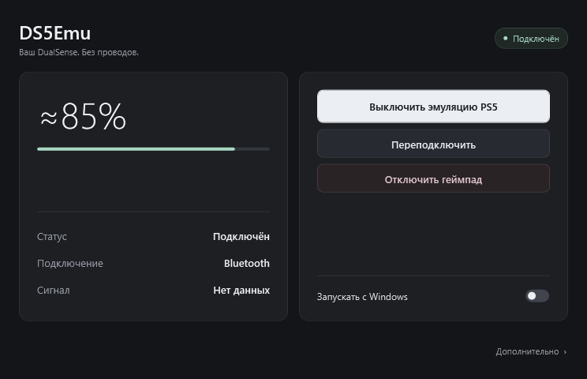



# DS5Emu

Полноценный DualSense по Bluetooth на Windows: игра видит виртуальный USB-контроллер PS5, а DS5Emu передаёт эффекты и звук на настоящий геймпад.

**[Скачать установщик](https://github.com/Q1W1RTY/DS5Emu/releases/tag/v0.1.14)** · [Инструкция](docs/user/INSTALL.md)

## Возможности

- Адаптивные курки и тактильная отдача.
- Динамик, микрофон и наушники через разъём геймпада.
- Кнопки, стики, тачпад, датчики движения и подсветка.
- Режим Xbox 360 / XInput с обычной вибрацией.
- Заряд батареи, работа в трее и отключение геймпада.
- Диагностика в дополнительном разделе, открывается по F12.

## Установка

1. Скачать и запустить **DS5Emu-Setup.exe** из [Releases](https://github.com/Q1W1RTY/DS5Emu/releases/tag/v0.1.14).
2. Установщик проверит драйверы. Для недостающих компонентов нажать «Установить», затем установить приложение. Совместимые имеющиеся драйверы пропускаются. Если потребуется, перезагрузить ПК.
3. Сопрячь DualSense с Windows по Bluetooth: удерживать **Create + PS** до мигания, затем добавить устройство в параметрах Windows.
4. Открыть DS5Emu и выбрать режим PS5 или Xbox.

Нужны **Windows 11 x64**, Bluetooth и один обычный DualSense. Для установки требуются права администратора.

## Что учитывать

- Для нативных эффектов нужна игра с поддержкой DualSense на ПК. Если мешает Steam Input, отключить его для этой игры.
- DSX и другие программы эмуляции на время работы DS5Emu нужно закрыть.
- Windows может переключить основной звук или микрофон на DualSense. При необходимости вернуть привычное устройство в настройках звука.
- Это ранняя версия. 0.1.12 опубликована как предварительная сборка; физическая игровая проверка режима Xbox ещё не завершена.
- Установщик пока не подписан сертификатом издателя. Драйверы используют собственные подписанные установщики.

## Исходники

[Сборка и тесты](docs/development/BUILD.md). Основа эмуляции: [vDS](https://github.com/hurryman2212/vds), драйверы: [usbip-win2](https://github.com/vadimgrn/usbip-win2) и [HidHide](https://github.com/nefarius/HidHide).
