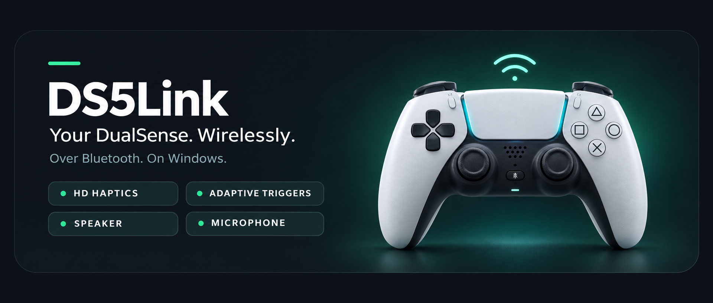
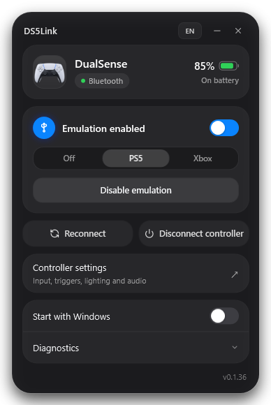
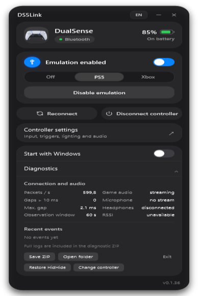
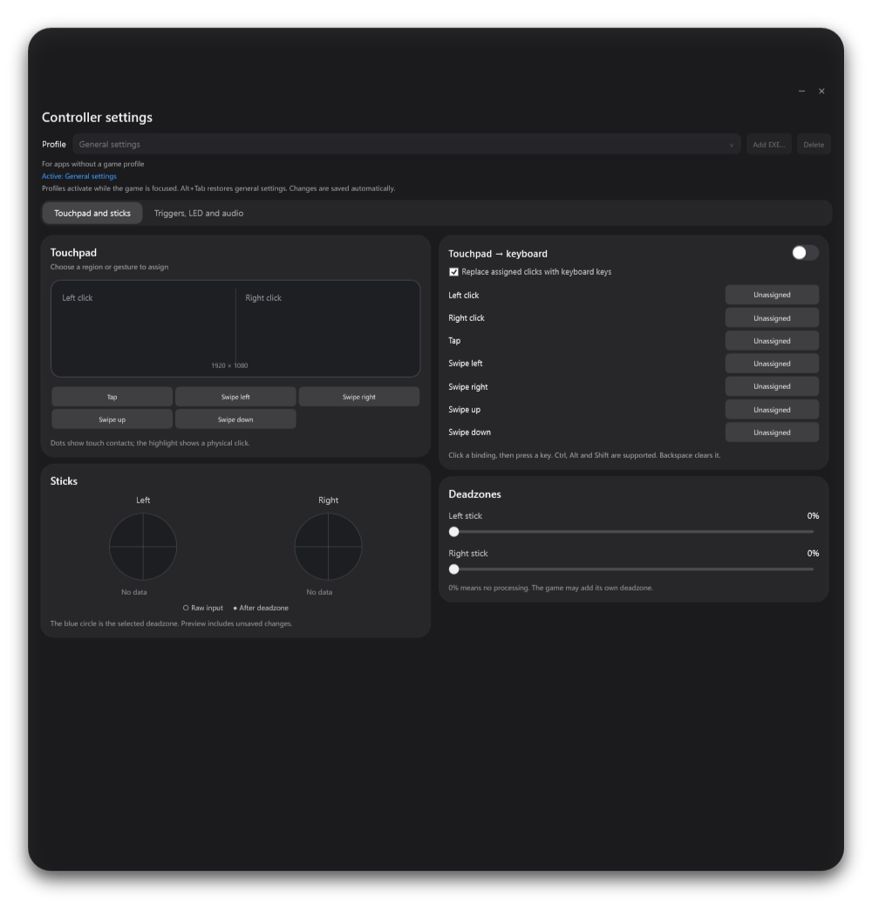
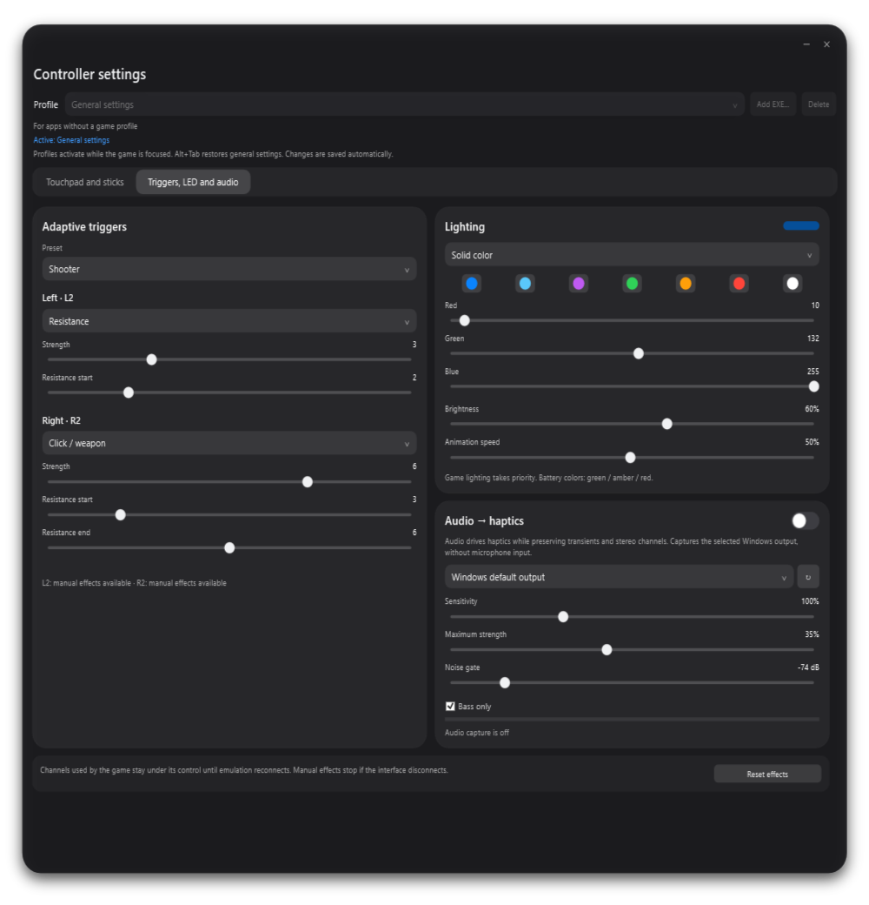

    

  

**English** · [Русский ↓](#russian)

## Your controller, more ways to play

DS5Link brings a virtual USB DualSense to Windows over Bluetooth. Use native adaptive triggers, HD haptics and controller audio in supported games, or switch to Xbox / XInput compatibility. Manage everything from a compact desktop app that stays in your tray.

| Mode | Connection | What you get |
| :--- | :--- | :--- |
| **PS5** | Bluetooth | Virtual USB DualSense, native triggers, HD haptics and controller audio in supported games |
| **Xbox** | Bluetooth or USB | Xbox 360 / XInput compatibility and standard rumble |

### Make it yours

- **Game profiles** — bind settings to a game's EXE and apply them when its window is focused.
- **Touchpad & sticks** — keyboard bindings for touchpad clicks and gestures, independent stick deadzones and live input previews.
- **Adaptive triggers** — tune L2 and R2 separately with resistance, weapon and pulse effects, or use a preset.
- **Lighting** — solid colors, pulse, rainbow and battery-level indication.
- **Audio → haptics** — turn a selected Windows audio output into haptic feedback, with sensitivity, strength and noise-gate controls.
- **Everyday essentials** — tray controls, optional startup with Windows, battery status and diagnostic ZIP export.

Games retain priority over manual effects on the channels they control. Audio → haptics is available in PS5 mode over Bluetooth.

## A closer look

Compact previews — click any image to open it at full size. UI previews from development build 0.1.36; release builds may differ.

<table>
<tr><th>Main window</th><th>Connection diagnostics</th></tr>
<tr>
<td align="center" valign="top"></td>
<td align="center" valign="top"></td>
</tr>
<tr><th>Touchpad & sticks</th><th>Triggers, lighting & audio</th></tr>
<tr>
<td align="center" valign="top"></td>
<td align="center" valign="top"></td>
</tr>
</table>

Installer & tray menu

 
<table>
<tr><th>Guided setup</th><th>Tray controls</th></tr>
<tr>
<td align="center" valign="top"></td>
<td align="center" valign="top"></td>
</tr>
</table>

## Up and running

**Requirements:** Windows 11 x64, one standard DualSense and a Bluetooth adapter for PS5 mode. Administrator rights are required for installation. DualSense Edge is not supported by this profile.

1. **[Download DS5Link-Setup.exe](https://github.com/Q1W1RTY/DS5Link/releases/latest/download/DS5Link-Setup.exe)** and run it.
2. Let setup check the bundled drivers, then install or repair any missing dependencies. Restart Windows if prompted.
3. Hold **Create + PS** until the controller flashes, then pair it in Windows Bluetooth settings.
4. Open DS5Link and select **PS5** or **Xbox**. For PS5 emulation, connect over Bluetooth; over USB, use the controller directly or select Xbox mode.

[Detailed installation guide (Русский)](docs/user/INSTALL.md) · [All releases](https://github.com/Q1W1RTY/DS5Link/releases)

### Good to know

- Native DualSense features depend on game support. If Steam Input interferes, disable it for that game; close other controller emulators such as DSX.
- Windows may select DualSense as the default audio device. Choose your usual speakers, headphones or microphone again if needed.
- The app installer is currently unsigned; bundled drivers use their own signed installers. Keep Windows security enabled.
- Game compatibility is still being tested. When reporting a problem, include the game, PS5/Xbox mode, connection type and a diagnostic ZIP.

## Built on good foundations

The controller engine is based on **[vDS](https://github.com/hurryman2212/vds)**, with **[usbip-win2](https://github.com/vadimgrn/usbip-win2)**, **[HidHide](https://github.com/nefarius/HidHide)** and **[ViGEmBus](https://github.com/nefarius/ViGEmBus)**.

[Build & test (Русский)](docs/development/BUILD.md) · [Architecture (Русский)](docs/architecture/ARCHITECTURE.md) · [Changelog](docs/releases/CHANGELOG.md) · [Issues](https://github.com/Q1W1RTY/DS5Link/issues)

---

## Русский

[↑ English](#readme) · **[Скачать](https://github.com/Q1W1RTY/DS5Link/releases/latest/download/DS5Link-Setup.exe)** · [Скриншоты](#screenshots) · [Инструкция](docs/user/INSTALL.md) · [Сообщить о проблеме](https://github.com/Q1W1RTY/DS5Link/issues)

**DS5Link — возможности проводного DualSense по Bluetooth на Windows.** В PS5-режиме приложение создаёт виртуальный USB DualSense для нативных курков, HD haptics и звука в поддерживаемых играх. Xbox-режим даёт совместимость с Xbox 360 / XInput по Bluetooth и USB.

### Что умеет

- **Профили игр:** привязка настроек к EXE и применение при активном окне игры.
- **Тачпад и стики:** назначения клавиш на нажатия и жесты, отдельные мёртвые зоны, предпросмотр ввода.
- **Адаптивные курки:** отдельная настройка L2 и R2, сопротивление, спуск, пульсация и пресеты.
- **Подсветка:** постоянный цвет, пульсация, радуга и индикация заряда.
- **Звук → haptics:** отдача от выбранного выхода Windows с настройкой чувствительности, силы и порога тишины; PS5-режим по Bluetooth.
- **На каждый день:** управление из трея, автозапуск, заряд батареи и экспорт диагностики в ZIP.

Игра имеет приоритет над ручными эффектами для каналов, которыми она управляет. [Галерея интерфейса ↑](#screenshots)

### Быстрый старт

Нужны **Windows 11 x64**, один обычный DualSense и Bluetooth-адаптер для PS5-режима. Для установки требуются права администратора. DualSense Edge этим профилем не поддерживается.

1. **[Скачайте DS5Link-Setup.exe](https://github.com/Q1W1RTY/DS5Link/releases/latest/download/DS5Link-Setup.exe)** и запустите его.
2. Установщик проверит комплект драйверов. Установите или восстановите недостающие компоненты и перезагрузите Windows, если мастер попросит.
3. Удерживайте **Create + PS** до мигания и добавьте DualSense в параметрах Bluetooth Windows.
4. Откройте DS5Link и выберите **PS5** или **Xbox**. Эмуляция PS5 работает по Bluetooth; по USB используйте контроллер напрямую или выберите Xbox.

[Подробная инструкция](docs/user/INSTALL.md) · [Все релизы](https://github.com/Q1W1RTY/DS5Link/releases)

### Что учитывать

- Нативные функции DualSense зависят от поддержки игры. Если мешает Steam Input, отключите его для этой игры; другие эмуляторы, включая DSX, закройте.
- Windows может выбрать DualSense основным звуковым устройством. При необходимости верните привычный выход или микрофон в параметрах звука.
- Установщик приложения пока без подписи издателя; установщики драйверов используют собственные подписи. Отключать защиту Windows не нужно.
- Проверка совместимости с играми продолжается. В сообщении о проблеме укажите игру, режим PS5/Xbox, тип подключения и приложите диагностический ZIP.

[Сборка и тесты](docs/development/BUILD.md) · [Архитектура](docs/architecture/ARCHITECTURE.md) · [История изменений](docs/releases/CHANGELOG.md)

**[Download / Скачать](https://github.com/Q1W1RTY/DS5Link/releases/latest/download/DS5Link-Setup.exe)** · [Releases](https://github.com/Q1W1RTY/DS5Link/releases) · [Issues](https://github.com/Q1W1RTY/DS5Link/issues)

