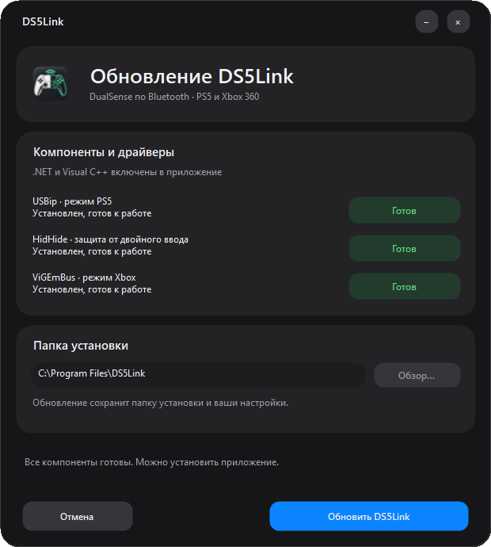
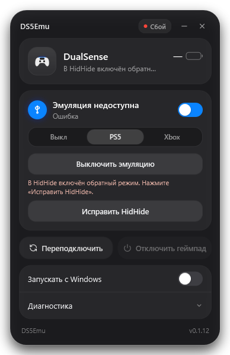

# DS5Emu: установка

Windows 11 x64, Bluetooth-адаптер и один обычный DualSense. Для установки нужны права администратора. DualSense Edge этим профилем не поддерживается.

Передать другу **DS5Emu-Setup.exe**. Остальные файлы релизной папки для установки не нужны.

1. Закрыть DSX и DS5Emu. Запустить EXE. Мастер покажет состояние USBip (PS5), HidHide и ViGEmBus (Xbox). Для отсутствующих компонентов нажать «Установить», для неполной или устаревшей установки — «Восстановить» и подтвердить запрос Windows.
2. Когда компоненты готовы, выбрать папку и установить приложение. Совместимые установленные драйверы, включая более новые версии, пропускаются. В комплект входят usbip-win2 0.9.8.1, HidHide 1.5.230.0 и ViGEmBus 1.22.0. После установки драйвера проверка повторяется. .NET и библиотеки Visual C++ включены. Все пакеты внутри EXE, SDK, Visual Studio и Python не нужны.
3. Если мастер просит перезагрузку, сохранить работу и перезагрузить Windows. Сам он компьютер не перезагружает. Установка USB/IP может временно переподключить USB-устройства.
4. Сопрячь DualSense с Windows: удерживать Create + PS до мигания, открыть «Параметры → Bluetooth и устройства → Добавить устройство → Bluetooth», выбрать контроллер.
5. Открыть DS5Emu из меню «Пуск», выбрать PS5 или Xbox. Программа сама находит один сопряжённый DualSense, адрес вручную не нужен. Если их несколько, оставить подключённым один.

Установщик DS5Emu пока не подписан сертификатом издателя: Windows может показать предупреждение о неизвестном издателе. Установщики драйверов имеют собственные подписи, их подписи и хеши проверяются. Защиту Windows отключать не нужно. Политика корпоративного ПК может запрещать установку.

Установленную другую версию общего драйвера мастер автоматически не заменяет. При несовпадении версии сообщает ошибку; не удалять общий драйвер вслепую, он может использоваться DSX. Для проверки подписи драйверов Windows может потребоваться доступ к службам сертификатов; сами пакеты установщик не скачивает.

При старой ZIP-поставке распаковать весь архив и запустить Setup.cmd. Запуск из просмотра архива не поддерживается.

При первой установке можно выбрать отдельную пустую папку, например D:\DS5Emu. Нужен постоянный локальный диск NTFS/ReFS; системные каталоги, профили пользователей, ссылки и небезопасные родительские папки не принимаются. Служба, ярлыки и удаление используют выбранный путь. При обновлении мастер сохраняет прежнюю папку, в том числе у версий, установленных в C:\Program Files\DSEmu. Для переноса сначала удалить приложение обычным способом и установить заново; настройки сохраняются.

## Использование

При первой установке служба в паузе. Открыть приложение и включить эмуляцию. Выключенный контроллер программа ждёт автоматически. Крестик и сворачивание прячут окно в трей.

«Выключить эмуляцию PS5» освобождает контроллер. «Отключить геймпад» разрывает соединение только с выбранным DualSense, сохраняя сопряжение и работу Bluetooth-адаптера. Для повторного подключения нажать PS. «Переподключить» перезапускает активную сессию. «Выход» в трее освобождает контроллер перед завершением.

При подключении настоящего USB DualSense программа освобождает его для прямого проводного использования. При обнаружении DSX также освобождает контроллер; чужие процессы не завершаются.

Для нативных эффектов нужна игра с поддержкой DualSense на ПК. Если Steam Input подменяет контроллер, отключить его в свойствах конкретной игры. Пользователь подтвердил корректную работу в Returnal; поведение на другом ПК ещё предстоит проверить.

«Дополнительно» или F12 открывает диагностику. ZIP сохраняется в %LocalAppData%\DSEmu\Diagnostics, адреса и пути устройств маскируются. Частота пакетов и интервалы ввода не являются пингом или процентом потерь. RSSI без достоверного источника не показывается.

## Интерфейс и диагностика

Запуск окна сохраняет выбранное состояние эмуляции. При неизвестном заряде показывается «—»; интервалы входных пакетов доступны в диагностике и не являются пингом Bluetooth. Ручной цвет подсветки и прочие незавершённые настройки недоступны.

В диагностике можно повторить восстановление HidHide после ошибки. Пока восстановление не завершено, успешное освобождение контроллера не подтверждается. «Сменить контроллер» доступно при выключенной эмуляции: оставить подключённым один обычный DualSense и подтвердить его выбор. Сопряжение Windows не удаляется.

## Звук

Windows может сама выбрать виртуальный DualSense основным микрофоном или аудиоустройством. При необходимости вернуть привычные устройства в параметрах звука Windows. Исправление автопереключения пока отложено.

Эффекты динамика и хаптика передаются отдельными каналами. Для обычного звука ПК в наушниках контроллера выбрать его аудиовыход средствами Windows.

## Обновление, ошибки и удаление

Запустить новый установщик. Настройки сохраняются. Замена файлов предусматривает возврат предыдущей версии при ошибке, прежние файлы остаются резервной папкой рядом с приложением. Обновление временно отключает контроллер; игру предварительно поставить на паузу.

Журнал мастера: %LocalAppData%\DS5Emu\Setup\last-setup.log. Подробности после начала установки с правами администратора: %ProgramData%\DSEmu\setup.log. При ошибке передать журналы разработчику.

Удаление: «Параметры → Приложения → Установленные приложения → DS5Emu». Сначала останавливается служба и восстанавливаются собственные изменения HidHide. Общие драйверы и диагностические данные сохраняются. При ошибке восстановления файлы и журнал остаются для ремонта. Не удалять папку вручную при активной эмуляции.

Проверка целостности без установки: DS5Emu-Setup.exe --verify-only C:\Temp\verification.json. Папка отчёта должна существовать. Проверяется распаковка и SHA256, а не работа драйверов.

## Компоненты

vDS (MIT): https://github.com/hurryman2212/vds
USB/IP: https://github.com/vadimgrn/usbip-win2
HidHide: https://github.com/nefarius/HidHide
Условия компонентов находятся в папке licenses приложения и их установщиках. Версии закреплены для воспроизводимой поставки.

## Режим Xbox

Кнопка «Xbox» создаёт виртуальный Xbox 360 (XInput) через ViGEmBus. Поддерживаются кнопки, крестовина, стики, аналоговые курки и обычная двухмоторная вибрация. Create соответствует Back, Options — Start, PS — Guide. Выбранный режим сохраняется службой. При переключении PS5 ↔ Xbox сначала освобождается предыдущий виртуальный контроллер.

Адаптивные курки, нативная хаптика, тачпад, гироскоп и аудиоустройства DualSense доступны в режиме PS5; XInput их не передаёт. Для Xbox требуется ViGEmBus — при его отсутствии приложение покажет сообщение с предложением воспользоваться установщиком.

ViGEmBus — архивный драйвер; в комплекте зафиксирована официальная версия 1.22.0: https://github.com/nefarius/ViGEmBus/releases/tag/v1.22.0 . Автообновление драйвера приложением не выполняется.

Версия 0.1.12 — кандидат: автоматические проверки не заменяют проверку ввода, вибрации и переключения режимов на физическом контроллере.

## Мастер установки

Внешний вид соответствует приложению: тёмные панели, синие основные действия и зелёные статусы готовых компонентов. В приложении доступны только Выкл, PS5 и Xbox; недоступная кнопка DS4 удалена.

## Диагностика

В разделе «Диагностика» показаны показатели соединения и звука, три последних события и действия восстановления. Повторы событий объединяются; подробная строка доступна по наведению. «Сохранить ZIP» собирает расширенный отчёт, включая технические DEBUG-строки. Идентификаторы устройства скрываются и в интерфейсе, и при экспорте.

Ручные настройки подсветки, вибрации, курков и частоты опроса удалены. Приложение не переопределяет цвет, силу отдачи или эффекты курков, присланные игрой.

### Расширенный ZIP (0.1.11)

Отчёт собирается даже без связи со службой, без перезапуска службы и изменения драйверов. В архив входят:

- status.json — ответ службы или последнее состояние интерфейса; connection.json явно отмечает, является ли оно сохранённым, и содержит результат попытки связи, тип ошибки и длительность.
- service.json — наличие и состояние службы, тип запуска, путь, PID, системный и служебный коды завершения.
- installation.json — версия и расположение установки, наличие файлов движка и библиотек, совпадение владельца с текущим пользователем без публикации SID.
- drivers.json — регистрация, состояние и версии USBip, HidHide и ViGEmBus.
- reboot.json — маркер перезагрузки приложения, время его записи относительно оценочного времени загрузки и признаки ожидающей перезагрузки Windows.
- logs/ — доступные хвосты установочных журналов, bridge.log, предыдущего bridge.log и bootstrap. Большие файлы ограничиваются 512 КиБ; сокращение явно отмечается в тексте.
- events/ — события Windows за последние семь дней только с упоминанием DS5Emu, DSEmuBridge или vdsd.exe (поиск ограничен 200 последними событиями выбранных источников; сохраняется до 30 подходящих событий).
- manifest.json — отдельный результат для каждого источника: collected, missing, accessDenied, timeout или error. Отсутствие необязательного файла не отменяет сбор остальных данных.

Установка/перезапуск приложения от администратора для обычного сбора не требуется. Если Windows запрещает чтение источника, отказ отражается в отчёте. Адреса контроллеров, SID, пути пользовательских профилей и учётные записи из заголовков установочных журналов скрываются.

### Обратный режим HidHide

Если появляется ошибка об обратном режиме HidHide, рядом с ней доступна кнопка «Исправить HidHide». Подтвердите переключение общего режима: приложение сначала приостановит эмуляцию, дождётся освобождения контроллера, отключит обратный режим и проверит результат. Списки устройств и приложений не очищаются; после успешного исправления восстанавливается выбранный режим PS5/Xbox, если эмуляция была включена.

Режим HidHide общий для всех программ, поэтому исправление не выполняется скрыто при установке или подключении. Если вы используете обратный режим для других устройств/программ, учитывайте, что изменятся правила доступа к скрытым устройствам. При незавершённом восстановлении или активном контроллере переключение блокируется.

### HidHide занят и выход при сбое службы

HidHide Configuration Client удерживает эксклюзивный доступ к драйверу. Перед включением эмуляции закройте это окно; ошибка доступа будет показана отдельно от ошибки обратного режима. При незавершённом восстановлении служба оставляет диагностическое соединение доступным; после закрытия клиента используйте «Восстановить HidHide».

Если служба недоступна и освобождение контроллера не подтверждено, «Выход» предлагает закрыть только интерфейс. Это не означает остановку службы или эмуляции; подтверждение не требуется при уже остановленной/отсутствующей службе.

